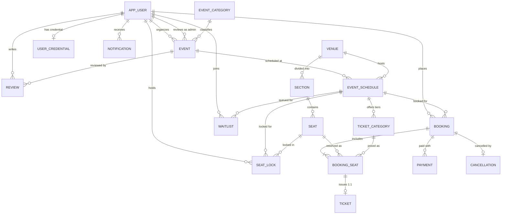

# EventFlow — Entity Relationship (ER) Model & Relational Mapping

## 1. Mermaid Entity-Relationship Diagram

---

## 2. Relational Schema Mapping & Cardinalities

### 1. `app_user`
- `user_id` (PK)
- `name`, `email` (UQ), `phone`, `role`, `account_status`, `created_at`, `updated_at`

### 2. `user_credential`
- `user_id` (PK, FK -> `app_user.user_id`)
- `password_hash`, `created_at`, `updated_at`
- *Cardinality:* 1:1 with `app_user`

### 3. `event_category`
- `category_id` (PK)
- `category_name` (UQ), `description`, `created_at`
- *Cardinality:* 1:M with `event`

### 4. `event`
- `event_id` (PK)
- `organizer_id` (FK -> `app_user.user_id`), `category_id` (FK -> `event_category.category_id`), `reviewed_by` (FK -> `app_user.user_id`)
- `title`, `description`, `approval_status`, `rejection_reason`, `created_at`, `updated_at`

### 5. `venue`
- `venue_id` (PK)
- `venue_name`, `address`, `capacity`, `created_at`
- *Cardinality:* 1:M with `section`, 1:M with `event_schedule`

### 6. `section`
- `section_id` (PK)
- `venue_id` (FK -> `venue.venue_id`)
- `section_name`
- *Composite Unique:* `(venue_id, section_name)`

### 7. `seat`
- `seat_id` (PK)
- `section_id` (FK -> `section.section_id`)
- `seat_number`
- *Composite Unique:* `(section_id, seat_number)`

### 8. `event_schedule`
- `schedule_id` (PK)
- `event_id` (FK -> `event.event_id`), `venue_id` (FK -> `venue.venue_id`)
- `start_datetime`, `end_datetime`, `schedule_status`, `created_at`
- *Constraint:* `end_datetime > start_datetime`

### 9. `ticket_category`
- `ticket_category_id` (PK)
- `schedule_id` (FK -> `event_schedule.schedule_id`)
- `category_name`, `price`
- *Composite Unique:* `(schedule_id, category_name)`

### 10. `seat_lock`
- `lock_id` (PK)
- `user_id` (FK -> `app_user.user_id`), `seat_id` (FK -> `seat.seat_id`), `schedule_id` (FK -> `event_schedule.schedule_id`)
- `locked_at`, `expires_at`, `lock_status`
- *Partial Unique Index:* `(seat_id, schedule_id) WHERE lock_status = 'Active'`

### 11. `booking`
- `booking_id` (PK)
- `user_id` (FK -> `app_user.user_id`), `schedule_id` (FK -> `event_schedule.schedule_id`)
- `booking_date`, `total_amount`, `booking_status`, `created_at`, `updated_at`

### 12. `booking_seat`
- `booking_seat_id` (PK)
- `booking_id` (FK -> `booking.booking_id`), `seat_id` (FK -> `seat.seat_id`), `ticket_category_id` (FK -> `ticket_category.ticket_category_id`)
- `price`
- *Composite Unique:* `(booking_id, seat_id)`

### 13. `payment`
- `payment_id` (PK)
- `booking_id` (FK -> `booking.booking_id`)
- `amount`, `payment_method`, `transaction_reference` (UQ), `payment_date`, `payment_status`

### 14. `ticket`
- `ticket_id` (PK)
- `booking_seat_id` (FK UQ -> `booking_seat.booking_seat_id`)
- `ticket_code` (UQ), `ticket_status`, `generated_at`

### 15. `cancellation`
- `cancellation_id` (PK)
- `booking_id` (FK UQ -> `booking.booking_id`)
- `cancelled_at`, `reason`, `refund_amount`, `cancellation_status`

### 16. `waitlist`
- `waitlist_id` (PK)
- `user_id` (FK -> `app_user.user_id`), `schedule_id` (FK -> `event_schedule.schedule_id`)
- `joined_at`, `position`, `waitlist_status`
- *Composite Unique:* `(user_id, schedule_id)`

### 17. `review`
- `review_id` (PK)
- `user_id` (FK -> `app_user.user_id`), `event_id` (FK -> `event.event_id`)
- `rating`, `review_text`, `review_date`
- *Composite Unique:* `(user_id, event_id)`

### 18. `notification`
- `notification_id` (PK)
- `user_id` (FK -> `app_user.user_id`)
- `title`, `message`, `type`, `is_read`, `created_at`
